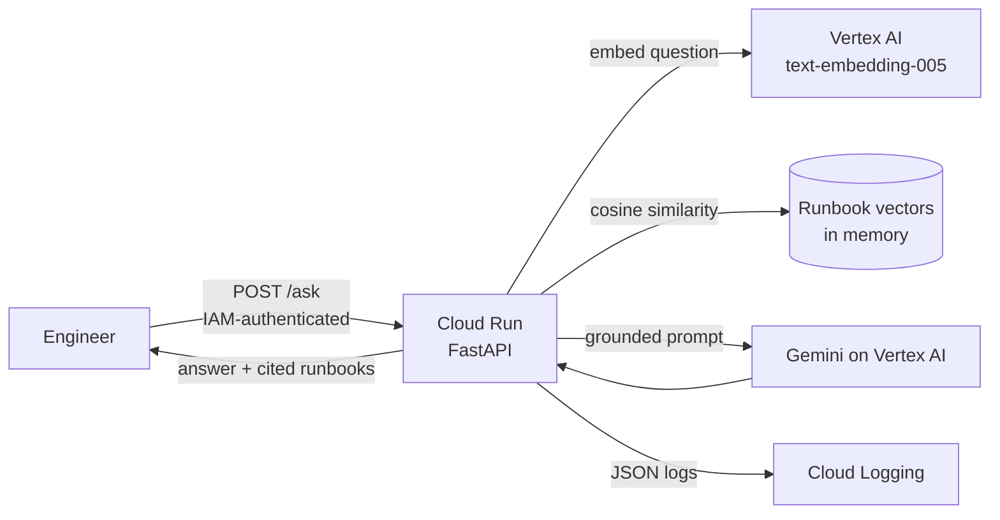
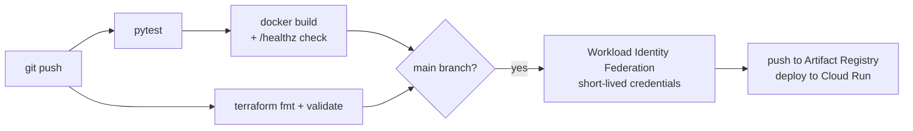

# GCP Runbook Assistant (Gemini RAG on Cloud Run)


An on-call assistant that answers incident questions such as "the RabbitMQ queue keeps growing, what do I check?" using **only** the team's runbooks.

- It finds the relevant runbook sections with **Vertex AI embeddings and vector search**.
- It asks **Gemini** to answer from those sections alone, and cites which runbook each step came from.
- It runs privately on **Cloud Run**.
- Infrastructure is **Terraform**, and GitHub Actions deploys with **Workload Identity Federation**, so no service account keys exist anywhere.

## Architecture



**How a question is answered**

1. On first request, the runbooks (`runbooks/*.md`) are split by heading and embedded with Vertex AI.
2. The question is embedded and compared against every section by cosine similarity. The top matches above a relevance threshold are kept.
3. Gemini gets a strict system prompt plus only those excerpts: answer only from the runbooks, cite the runbook name for each step, never invent commands or credentials, and say "escalate" when unsure.
4. **If nothing relevant is found, Gemini is never called.** The API returns an escalation message instead of guessing.

## AI guardrails and governance

| Concern | How it's handled |
|---|---|
| Hallucination | Answers are grounded only in retrieved excerpts, low temperature (0.2), and no model call without context |
| Traceability | Every answer returns the runbooks it used, with similarity scores |
| Access | Cloud Run is private (`--no-allow-unauthenticated`); callers need IAM `run.invoker` |
| Least privilege | The runtime service account only has `roles/aiplatform.user` |
| Cost and abuse | Max 1 instance, 1,000-character question limit, capped output tokens |
| Observability | One structured JSON log line per request (latency, sources, answered or not), searchable in Cloud Logging |

## CI/CD



Tests run offline. The retrieval and prompt logic in `app/rag.py` takes the embedder and model as plain functions, so tests swap in fakes. The tests cover:

- chunking
- ranking
- grounding the prompt
- the no-match escalation path
- input validation

## One-time setup

You need a Google Cloud project with billing enabled (new accounts get free trial credits), the `gcloud` CLI, and Terraform. Cloud Shell has both.

```bash
gcloud auth application-default login
# New projects: link billing, then turn on the API Terraform uses to manage other APIs
gcloud services enable cloudresourcemanager.googleapis.com serviceusage.googleapis.com
cd terraform
cp terraform.tfvars.example terraform.tfvars   # set your project_id
terraform init && terraform apply
```

Then in GitHub, go to **Settings → Secrets and variables → Actions → Variables** and add:

| Variable | Value |
|---|---|
| `GCP_PROJECT_ID` | your project ID |
| `GCP_REGION` | `us-central1` |
| `GCP_WIF_PROVIDER` | `workload_identity_provider` output |
| `GCP_DEPLOYER_SA` | `deployer_service_account` output |
| `GCP_RUNTIME_SA` | `runtime_service_account` output |

Push to `main` and the pipeline deploys.

## Try it

```bash
URL=$(gcloud run services describe runbook-assistant --region us-central1 --format 'value(status.url)')
curl -s -X POST "$URL/ask" \
  -H "Authorization: Bearer $(gcloud auth print-identity-token)" \
  -H "Content-Type: application/json" \
  -d '{"question": "RabbitMQ queue depth keeps growing. What should I check first?"}'
```

Or open it in your browser without making it public: `gcloud run services proxy runbook-assistant --region us-central1`, then go to http://localhost:8080/docs.

## Run locally

```bash
python3 -m venv .venv && source .venv/bin/activate
pip install -r requirements.txt -r requirements-dev.txt
pytest -v
export GCP_PROJECT=your-project-id GCP_LOCATION=us-central1
uvicorn app.main:app --reload    # uses your gcloud application-default credentials
```

## Cost

Cloud Run scales to zero. Embeddings and Gemini Flash calls cost fractions of a cent each, and the in-memory index has no hourly cost.

When the runbook set grows into the thousands, replace the in-memory index with Vertex AI Vector Search. Only `RunbookIndex.search` changes.

Clean up with `terraform destroy`, plus `gcloud run services delete runbook-assistant`.

## Layout

```
.
├── app/
│   ├── rag.py        # chunking, embeddings index, cosine search, grounded prompt (no cloud SDK)
│   ├── vertex.py     # Vertex AI embedder and Gemini generator
│   └── main.py       # FastAPI: /healthz, /ask
├── runbooks/         # sample on-call runbooks (Markdown)
├── tests/            # pytest, fully offline
├── terraform/        # APIs, Artifact Registry, service accounts, Workload Identity Federation
├── Dockerfile        # non-root Python image for Cloud Run
└── .github/workflows/ci-cd.yml
```
